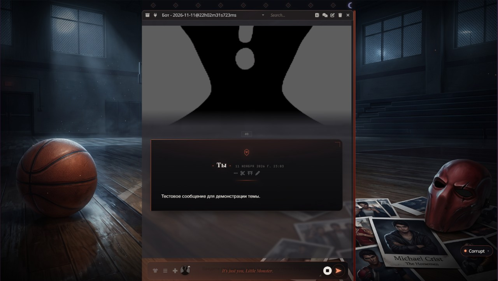
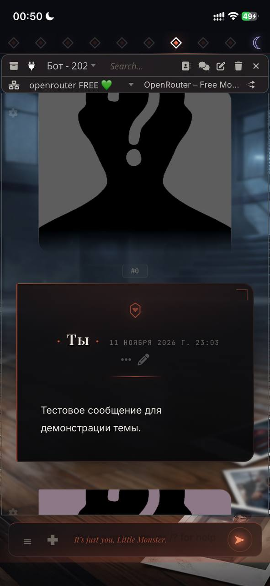
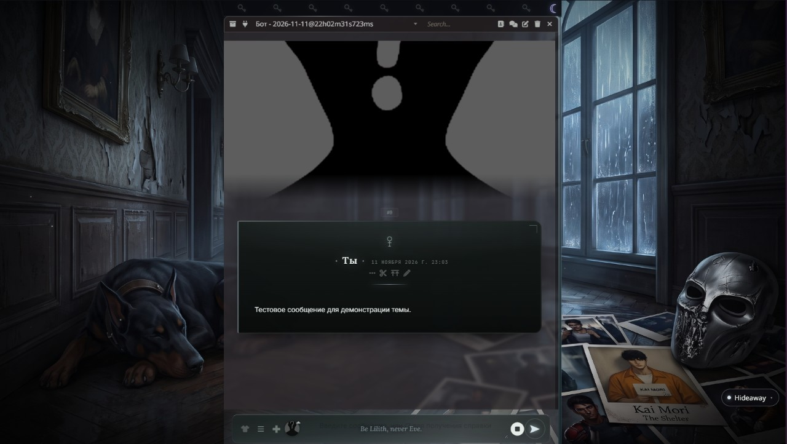
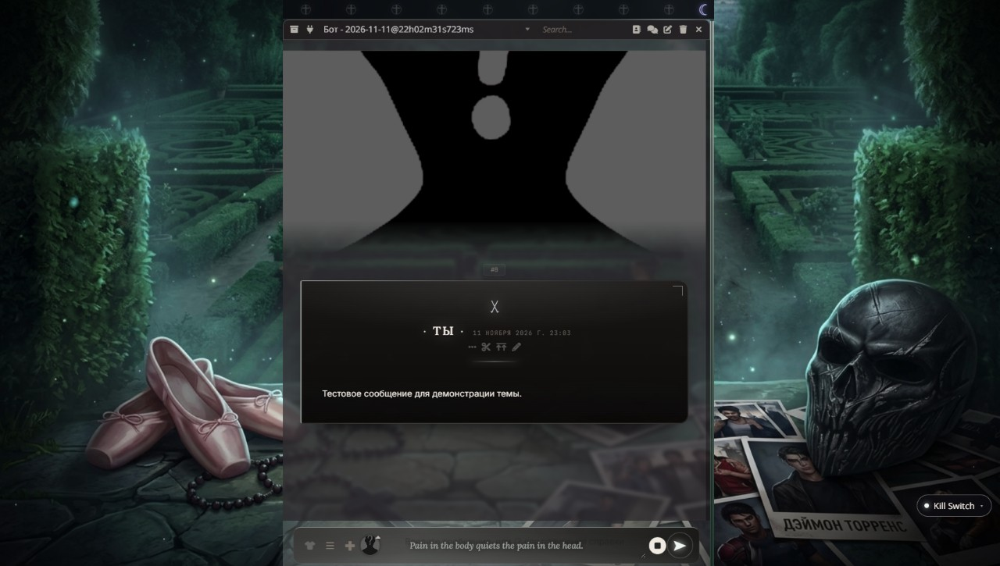
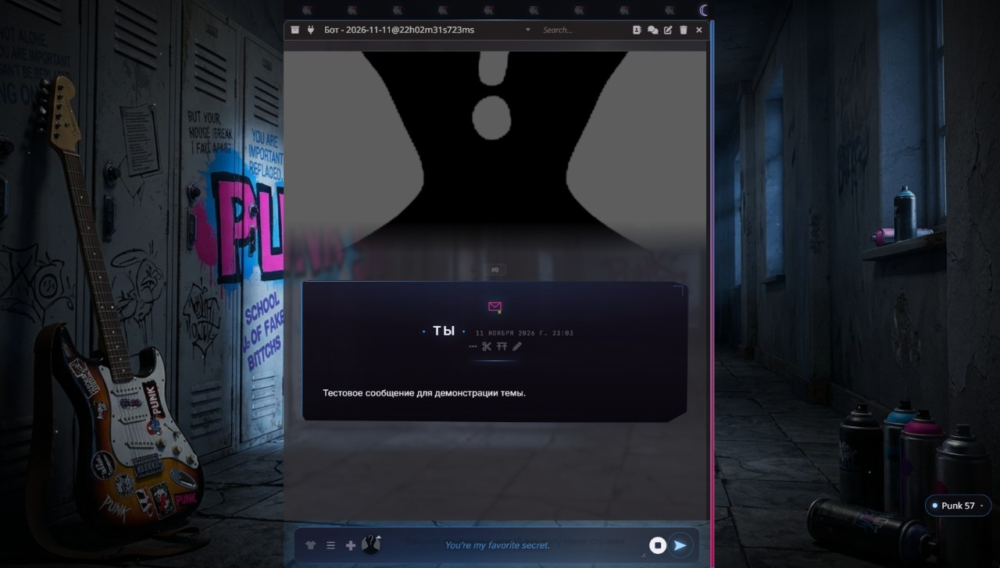
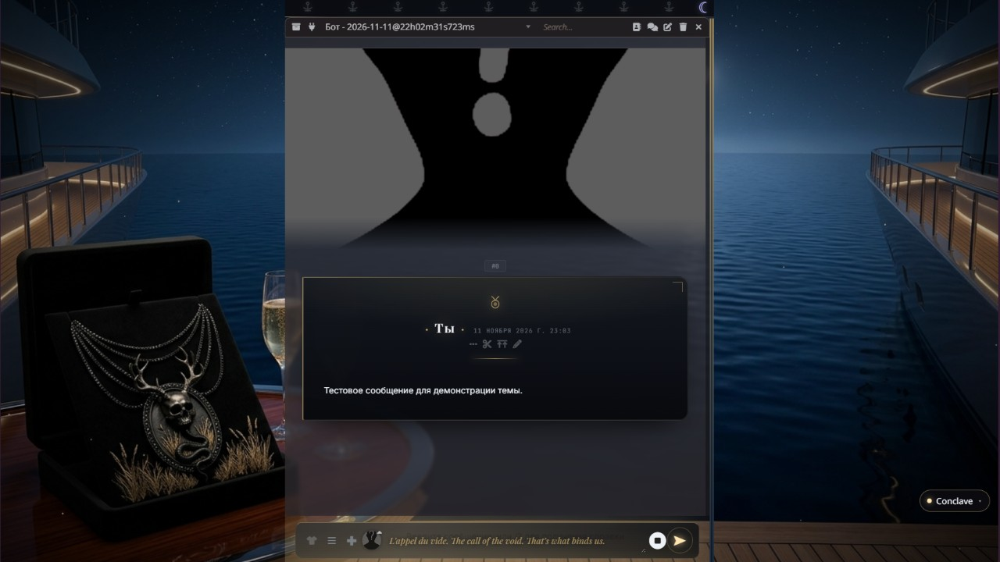
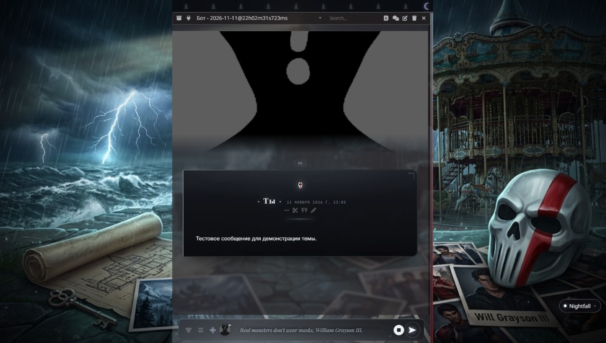

<div align="center">

# ✦ DEVIL'S NIGHT MODES ✦

**Шесть книжных режимов для SillyTavern по серии «Ночь Дьявола» Пенелопы Дуглас.**
Один движок на переменных — переключение на лету, без перезагрузки и без правки кода.

[](https://github.com/satsvi97/devils-night-modes/releases)
[](LICENSE)
[](https://github.com/SillyTavern/SillyTavern)
[](#языки)
[](https://t.me/+vJVPtuqeHu85ZjU6)

[Режимы](#режимы) · [Установка](#установка) · [Свои фоны](#свои-фоны) · [Языки](#языки) · [FAQ](#если-что-то-не-так)
<br>
[English](#english) · [Українська](#українська) · [Svenska](#svenska) · [**▶ Демо**](https://satsvi97.github.io/devils-night-modes/demo/)

</div>

---

<table>
<tr>
<td width="70%"></td>
<td width="30%"></td>
</tr>
<tr>
<td align="center"><sub>ПК</sub></td>
<td align="center"><sub>телефон</sub></td>
</tr>
</table>

## Режимы

| | Режим | Палитра | Якоря |
|---|---|---|---|
| 🩸 | **Corrupt** | кровь, сталь, красный | школьный спортзал, баскетбольный мяч, красная маска |
| 🌲 | **Hideaway** | хвоя, туман, тёплое окно | отель «Понтифик», стена леса, лифт «12», ключ |
| ⛪ | **Kill Switch** | воск, камень, витраж | лабиринт, фонтан, черепная маска, крест |
| 🎸 | **Punk 57** | электрик-синий, неон | коридор со шкафчиками, граффити, пятна краски |
| 🥂 | **Conclave** | шторм, золото | яхта, луна, шампанское, кольцо |
| 🗼 | **Nightfall** | маяк, холод | маяк и луч, штормовое море, карусель, маска |

<table>
<tr>
<td></td>
<td></td>
</tr>
<tr>
<td align="center"><b>Hideaway</b> · <i>«Be Lilith, never Eve.»</i></td>
<td align="center"><b>Kill Switch</b> · <i>«Pain in the body quiets the pain in the head.»</i></td>
</tr>
<tr>
<td></td>
<td></td>
</tr>
<tr>
<td align="center"><b>Punk 57</b> · <i>«You're my favorite secret.»</i></td>
<td align="center"><b>Conclave</b> · <i>«L'appel du vide. That's what binds us.»</i></td>
</tr>
<tr>
<td colspan="2"></td>
</tr>
<tr>
<td colspan="2" align="center"><b>Nightfall</b> · <i>«Real monsters don't wear masks, William Grayson III.»</i></td>
</tr>
</table>

## Что внутри

- **Шесть режимов** — Corrupt, Hideaway, Kill Switch, Punk 57, Conclave, Nightfall.
- **Переключение на лету** — из меню расширений, плавающей кнопкой или командой `/dn`.
- **Свои фоны** — папка `backgrounds/`, файл подхватывается автоматически.
- **Тематические иконки** верхней панели: ромбы, ключ, готический крест, баллон, якорь, ель.
- **Цитаты из книг** в подсказке поля ввода — своя у каждого режима.
- **Живой фон**: мелкие пылинки, у каждой своя скорость, снос и задержка.
- **Одна кнопка отправки**: самолётик в покое, квадрат с вращающимся кольцом во время генерации.
- **Четыре языка** интерфейса расширения: русский, English, українська, svenska.
- `prefers-reduced-motion` выключает фоновые анимации.

## Установка

**Способ 1 — из таверны (рекомендую):**

1. SillyTavern → **Extensions** → **Install extension**
2. Вставить: `https://github.com/satsvi97/devils-night-modes`
3. Перезагрузить страницу с `Ctrl+F5`

**Способ 2 — вручную:**

```bash
cd SillyTavern/data/default-user/extensions
git clone https://github.com/satsvi97/devils-night-modes
```

**Способ 3 — архив:** скачать ZIP из [Releases](https://github.com/satsvi97/devils-night-modes/releases), распаковать в `data/default-user/extensions/devils-night-modes`.

После установки в правом нижнем углу появится кнопка с названием режима, а в **Extensions** — блок **✦ DEVIL'S NIGHT MODES ✦** с тумблером, выбором режима и языка.

## Команды

| Команда | Что делает |
|---|---|
| `/dn` | список режимов |
| `/dn corrupt` · `hideaway` · `killswitch` · `punk57` · `conclave` · `nightfall` | переключить режим |
| `/dn off` | выключить оформление |
| `/dn ru` · `en` · `uk` · `sv` | сменить язык интерфейса |

## Свои фоны

Положите файл в `backgrounds/` — и он подставится сам:

```
backgrounds/
├── corrupt.jpg      Corrupt
├── hideaway.jpg     Hideaway
├── killswitch.jpg   Kill Switch
├── punk57.jpg       Punk 57
├── conclave.jpg     Conclave
└── nightfall.jpg    Nightfall
```

- размер: 1920×1080 хватит, `background-size: cover` не даст мыла;
- нет файла — режим работает на чистом CSS, ничего не ломается;
- фон ложится под тонировку, поэтому автоматически попадает в палитру режима.

## Языки

Переключаются в настройках расширения и командой `/dn <код>`:

| Код | Язык |
|---|---|
| `ru` | Русский |
| `en` | English |
| `uk` | Українська |
| `sv` | Svenska |

Выбор запоминается в настройках.

## Если что-то не так

**Не видно фона.** Проверьте, что файлы лежат в
`data/default-user/extensions/devils-night-modes/backgrounds/` и названы латиницей (`hideaway.jpg`, а не `Убежище.jpg`).

**Не видно кнопки отправки.** Обновите расширение и страницу с `Ctrl+F5` — в версиях до 1.2.5 кнопку мог прятать конфликт с попапом персонажей.

**Иконки не такие, как на скриншотах.** Скорее всего, в *User Settings → Custom CSS* остался старый текст темы: он грузится после расширения и перебивает правила. Для чистого вида поле лучше очистить.

**Фон «плывёт» на телефоне.** На iOS `background-attachment: fixed` работает нестабильно — в расширении для узких экранов уже стоит `scroll`. Если что-то не так, обновите страницу целиком.

## Структура

```
manifest.json      описание расширения (для установки по URL)
index.js           переключатель режимов, языки, пылинки
style.css          сам движок темы и все шесть режимов
backgrounds/       ваши фоны книги
previews/          скриншоты (ПК и телефон)
demo/              автономное превью без SillyTavern
```

## Благодарности

Сделано вместе с **Selena's Tavern** — идеи, канон и фоны от неё.
Серия «Ночь Дьявола» принадлежит Пенелопе Дуглас; проект фанатский и не аффилирован с автором.

Лицензия — [MIT](LICENSE). Шрифты — Google Fonts (OFL).

<div align="center">
<sub>Сделано с любовью · ✦ Selena's Tavern ✦</sub>
<br>
<a href="https://t.me/+vJVPtuqeHu85ZjU6">Telegram-канал →</a>
</div>

---

<details>
<summary><h2 id="english">🇬🇧 English</h2></summary>

### ✦ DEVIL'S NIGHT MODES ✦

Six book modes for SillyTavern, inspired by Penelope Douglas' *Devil's Night* series.
One engine driven by CSS variables — switch modes live, no reload, no code editing.

**Modes:** Corrupt · Hideaway · Kill Switch · Punk 57 · Conclave · Nightfall.

**Install:** Extensions → Install extension → `https://github.com/satsvi97/devils-night-modes` → `Ctrl+F5`.

**Commands:** `/dn` (list), `/dn corrupt`, `/dn hideaway`, `/dn killswitch`, `/dn punk57`, `/dn conclave`, `/dn nightfall`, `/dn off`, `/dn en` (language).

**Custom backgrounds:** drop `corrupt.jpg`, `hideaway.jpg`, `killswitch.jpg`, `punk57.jpg`, `conclave.jpg`, `nightfall.jpg` into `backgrounds/`. Missing files simply mean the mode falls back to pure CSS.

**Features:** per-mode icons, a book quote in the input placeholder, independent dust motes, a single send button that turns into a stop button with a spinning ring while generating, four UI languages (RU/EN/UK/SV), `prefers-reduced-motion` support.

**Troubleshooting:** if icons look different than on screenshots, clear *User Settings → Custom CSS* — old theme CSS is injected after the extension and overrides it.

</details>

<details>
<summary><h2 id="українська">🇺🇦 Українська</h2></summary>

### ✦ DEVIL'S NIGHT MODES ✦

Шість книжкових режимів для SillyTavern за серією «Ніч Диявола» Пенелопи Дуглас.
Один рушій на CSS-змінних — перемикання на льоту, без перезавантаження й без правок коду.

**Режими:** Corrupt · Hideaway · Kill Switch · Punk 57 · Conclave · Nightfall.

**Встановлення:** Extensions → Install extension → `https://github.com/satsvi97/devils-night-modes` → `Ctrl+F5`.

**Команди:** `/dn` (список), `/dn corrupt`, `/dn hideaway`, `/dn killswitch`, `/dn punk57`, `/dn conclave`, `/dn nightfall`, `/dn off`, `/dn uk` (мова).

**Свої фони:** покладіть `corrupt.jpg`, `hideaway.jpg`, `killswitch.jpg`, `punk57.jpg`, `conclave.jpg`, `nightfall.jpg` у теку `backgrounds/`. Якщо файлу немає — режим працює на чистому CSS.

**Можливості:** тематичні іконки, цитата з книги в підказці поля вводу, незалежні пилинки, одна кнопка надсилання, що перетворюється на «стоп» із кільцем під час генерації, чотири мови інтерфейсу (RU/EN/UK/SV), підтримка `prefers-reduced-motion`.

**Якщо іконки виглядають інакше:** очистіть *User Settings → Custom CSS* — старий CSS теми завантажується після розширення й перекриває його.

</details>

<details>
<summary><h2 id="svenska">🇸🇪 Svenska</h2></summary>

### ✦ DEVIL'S NIGHT MODES ✦

Sex boklägen för SillyTavern, inspirerade av Penelope Douglas serie *Devil's Night*.
En motor byggd på CSS-variabler — byt läge direkt, utan omladdning och utan kodändringar.

**Lägen:** Corrupt · Hideaway · Kill Switch · Punk 57 · Conclave · Nightfall.

**Installation:** Extensions → Install extension → `https://github.com/satsvi97/devils-night-modes` → `Ctrl+F5`.

**Kommandon:** `/dn` (lista), `/dn corrupt`, `/dn hideaway`, `/dn killswitch`, `/dn punk57`, `/dn conclave`, `/dn nightfall`, `/dn off`, `/dn sv` (språk).

**Egna bakgrunder:** lägg `corrupt.jpg`, `hideaway.jpg`, `killswitch.jpg`, `punk57.jpg`, `conclave.jpg`, `nightfall.jpg` i mappen `backgrounds/`. Saknas filen används ren CSS.

**Funktioner:** temanpassade ikoner, ett citat från boken i inmatningsfältet, oberoende dammpartiklar, en skicka-knapp som blir en stopp-knapp med roterande ring under generering, fyra språk i gränssnittet (RU/EN/UK/SV), stöd för `prefers-reduced-motion`.

**Felsökning:** om ikonerna ser annorlunda ut än på skärmbilderna, töm *User Settings → Custom CSS* — gammal temacss laddas efter tillägget och skriver över det.

</details>
