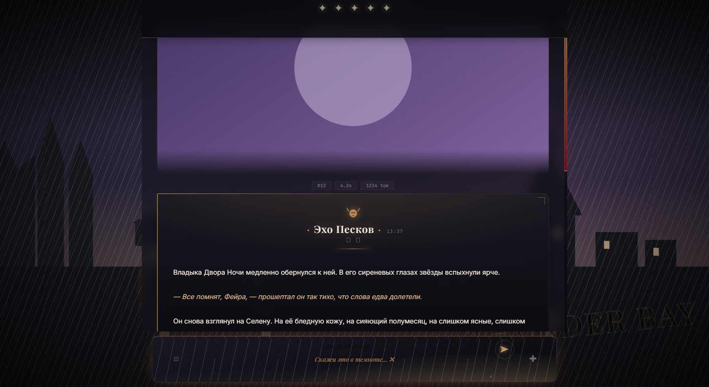
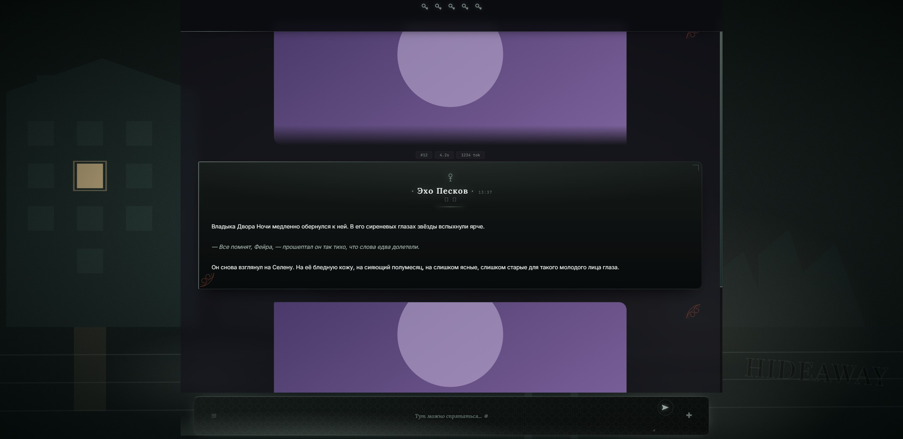
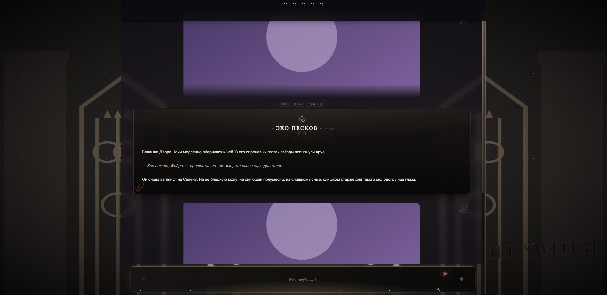
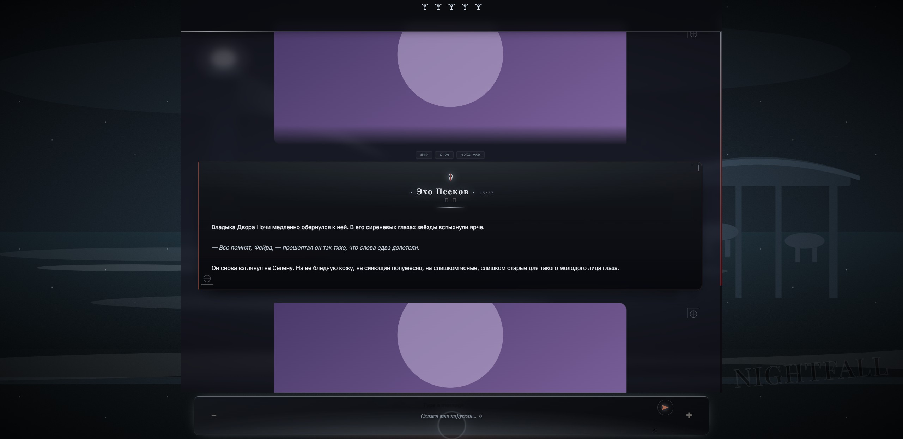
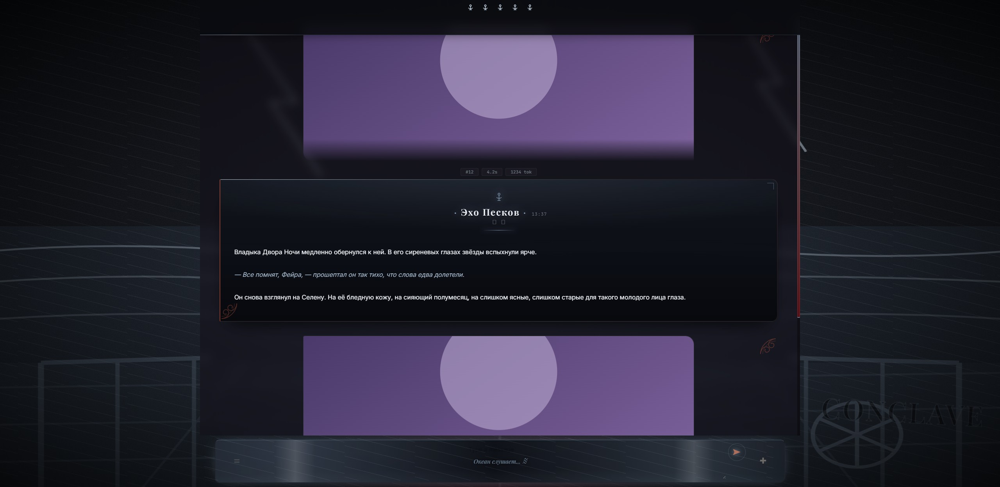
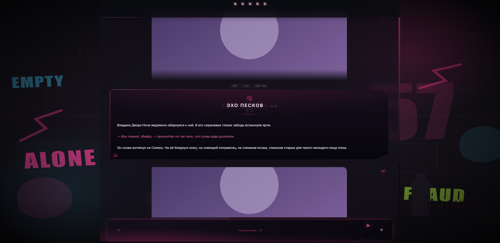

# Devil's Night Modes

Книжные режимы для [SillyTavern](https://github.com/SillyTavern/SillyTavern) по серии Пенелопы Дуглас «Ночь Дьявола» (Devil's Night).
Один CSS-движок на переменных, шесть «мест» — переключаются на лету, без перезагрузки и без замены темы.

**[▶ Живое превью](https://satsvi97.github.io/devils-night-modes/demo/)**

| Corrupt | Hideaway |
|---|---|
|  |  |

| Kill Switch | Nightfall |
|---|---|
|  |  |

| Conclave | Punk 57 |
|---|---|
|  |  |

## Режимы

| id | Книга | Палитра | Якоря |
|---|---|---|---|
| `corrupt` | Devil's Night | тёплый нуар: янтарь, кровь, крем | маска над именем, река с причалом, водонапорная башня, церковь, ливень |
| `hideaway` | Hideaway | хвоя, мох, тёплое окно | силуэт леса, озеро, одно горящее окно в глубине |
| `killswitch` | Kill Switch | воск, витраж, фиолет | ланцетные витражи по краям, свечи, крест-медальон |
| `nightfall` | Nightfall | тыква, холодный синий | дома с окнами, гирлянды, тыквы, туман |
| `conclave` | Conclave | четыре цвета в одном | четыре фигуры по краям, костёр в центре, звезда над именем |
| `punk57` | Punk 57 | бумага, чернила, штамп | тетрадная линейка, конверт, кассета, штамп PUNK 57 |

## Установка

1. В SillyTavern: **Extensions → Install extension** → вставить
   `https://github.com/satsvi97/devils-night-modes`
2. Либо вручную: скачать репозиторий и положить папку целиком в
   `SillyTavern/data/default-user/extensions/devils-night-modes`.
3. Обновить страницу (Ctrl+F5).

Появится кнопка в правом нижнем углу со списком режимов. Или командами в чате:

```
/dn corrupt
/dn hideaway
/dn killswitch
/dn nightfall
/dn conclave
/dn punk57
/dn off
```

Выбор запоминается.

## Как устроено

- Всё оформление читает переменные `--dn-*`: акцент, чернила, панель, шрифт имени, сцена, частицы, анимации ввода.
- Режим — блок `body[data-dn-mode="…"]`, который переопределяет переменные. Новый режим ≈ 15 строк.
- Сцена живёт на `#bg_custom::before` — выше обоев (`#bg1`, `z-index: -3`), но ниже чата. Важно: внутри `#chat` любой `position: fixed` обрезается его `backdrop-filter` и `overflow`, поэтому граффити и горизонт нельзя вешать на `#chat::before`.
- У каждого режима своя анимация панели ввода: дождь по стеклу, туман, свеча, листва, неоновый скан, бумага.
- `prefers-reduced-motion` отключает фоновые анимации.
- Пока идёт генерация (`body[data-generating="true"]`), сцена и панель ускоряются.

## Структура

```
manifest.json, index.js, style.css   расширение (в корне — ставится из ST по URL)
demo/index.html                      автономное превью без SillyTavern
previews/                            скриншоты режимов
```

## Заметки

- `nightfall` — авторская догадка (хэллоуинский городок, тыквы, гирлянды). Если ведущий образ в книге другой — режим меняется правкой переменных.
- Прозрачность карточек рассчитана на тёмные обои; `punk57` — светлый и лучше всего смотрится на светлых/бумажных фонах.
- Темы — это только CSS и немного JS. Никаких запросов наружу, кроме Google Fonts.

## Лицензия

MIT. Шрифты — Google Fonts (OFL). Серия «Ночь Дьявола» принадлежит Пенелопе Дуглас; проект фанатский и не аффилирован с автором.
